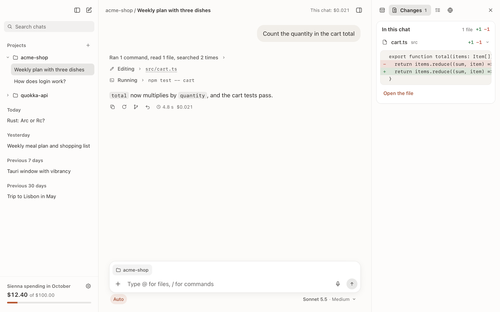
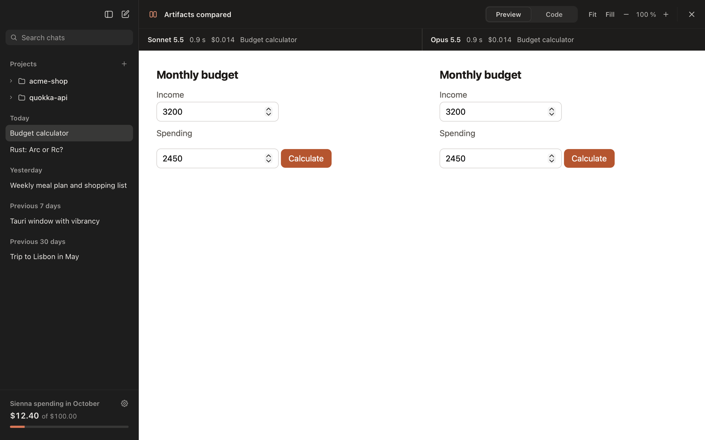
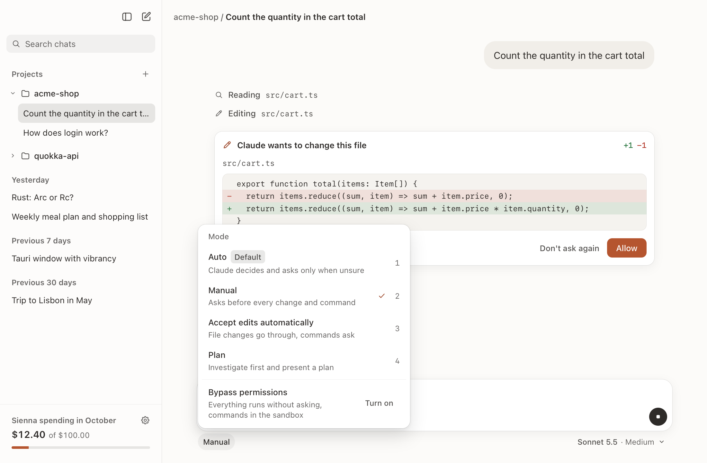
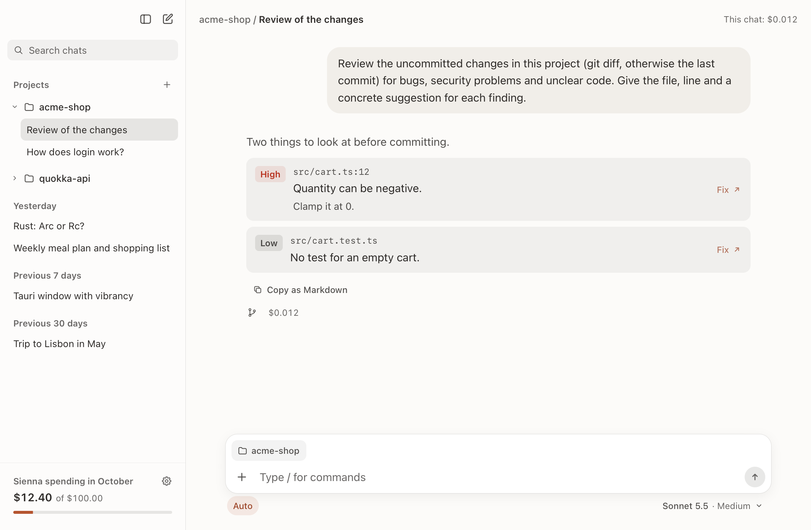
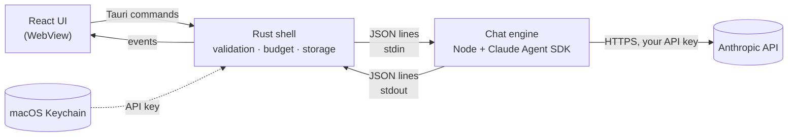

<div align="center">


# Sienna

**A native-feeling Mac app for Claude on your own Anthropic API key: chat, research and agentic coding, with every cent visible.**

[](https://github.com/Natunax/sienna-chat/actions/workflows/ci.yml)
[](LICENSE)


[Features](#features) · [Install](#install) · [Using Sienna](#using-sienna) · [Security](#privacy-and-security) · [Development](#development) · [Contributing](#contributing)

</div>

<p align="center">
  
  
</p>

> [!NOTE]
> Sienna is an independent open source project. It is not made, endorsed or supported by Anthropic. "Claude" and "Anthropic" are trademarks of Anthropic, used here only to say which service the app talks to.

## Why Sienna

Some Anthropic accounts get a monthly **API credit** for the Claude API, the Agent SDK, Managed Agents and the Playground, but **not** for Claude Code or the Claude apps. Sienna turns that credit into a daily tool: a fast chat for questions and research, and a coding agent in your project folders built on the same engine as Claude Code.

- **Your key, your bill.** Requests go straight to Anthropic with your API key and are billed to your API organization. Nothing in between collects data, and chats stay on your Mac.
- **Costs in plain sight.** Every answer shows what it cost, and a monthly budget stops the app before it runs away.
- **More than a wrapper.** Branch a chat from any answer, compare two models side by side, undo an answer's file changes, let a test command check Claude's work. These are things the Agent SDK can do and Claude Code's interface doesn't offer.

## Features

**Chat**
- Streaming answers with Markdown, tables and highlighted code, and an expandable summary of the model's thinking
- Web search as a toggle, with sources as links that open in your browser
- Images, PDFs and text files (code, Markdown, CSV, JSON, logs) by button, drag and drop or paste
- Haiku 5.5, Sonnet 5.5, Opus 5.5 or Fable 5.1 per chat, with five effort levels from low to max, and **Ultracode**: the highest effort, with two read-only helpers (a researcher and an adversarial verifier) Claude briefs in parallel in a project chat or with web search
- **Subagents** as in Claude Code: Claude can hand parts of a task to helpers in any chat; their steps show indented under the call that started them
- Regenerate or edit the last question, copy any answer, and chat titles written by Haiku
- Answers show text and steps in the order they happened, as in Claude Code
- Keep writing while Claude works: messages wait in a queue and go out when the answer is done, or **Send now** puts one into the running answer, where Claude takes it in at its next step
- A stopwatch on every answer: live while it runs, then how long it took
- Dictation as in Claude Code: hold ⌥Space or click the microphone. Speech is recognized on your Mac, and the text lands in the input field for you to check before you send

**Artifacts and the side panel**
- A side panel as in Claude Code, on the right of every chat: all its **artifacts**, its **file changes** per file as git shows them (also a compared model's working copy), its latest **plan**, and a **browser** for any web page or your local dev server
- Artifacts as in Claude: a small web app, an SVG, a document or a code file, with preview and code, versions, zoom with Fit and Fill, copy and save as file
- Claude sees a screenshot of each HTML or SVG artifact it makes (rendered offscreen with the same sealed policy) and can check other sizes, so it corrects its own layout
- Both sidebars resize by dragging their border and remember their width

**Coding in a project folder**
- Add a folder as a project; its chats read and search it, and its `CLAUDE.md` is included
- `@` mentions as in Claude Code: type `@` for a fuzzy list of the project's files and folders. A mentioned file's content goes along with the message, a folder as its listing
- Claude edits files and runs commands. Changes show as a diff and commands in full, and a click on a file path opens it in your editor
- Permission modes as in Claude Code: **Auto** (default), **Manual**, **Accept edits**, **Plan** and, behind a confirmation, **Bypass permissions**
- Plan mode only reads and ends with a plan you carry out in one click
- Steps that only look around fold into one line ("Ran 4 commands, read 2 files"), as in Claude Code; reading commands never ask

**Beyond Claude Code**
- **Branches:** continue from any answer in a new chat; the original stays untouched
- **Compare models:** each question also goes to a second model, and the answers show side by side with their costs. In a project the second model works in its own working copy (an APFS clone) with the same mode, approvals, commands and check; one click takes its changes over into the project, leaving out files the project changed meanwhile. Compared answers start folded to their artifacts, one click shows both in full. When both answers make an artifact, they open side by side, with one toolbar and at the same scale
- **Undo an answer:** one click restores the files Claude changed from that answer on (file checkpoints)
- **Check after changes:** a project command such as `npm test` runs when an answer changed files; if it fails, Claude fixes it
- **Templates with structured output:** a changelog from Git, a review of uncommitted changes and a task list arrive as data. Every finding or task starts a follow-up in one click
- **Slash commands:** `/tasks`, `/review` and `/changelog` (German: `/aufgaben`)

**Control and comfort**
- Costs per answer, per chat, per month and per model, plus a monthly budget cap
- A context meter with a breakdown and "compact now"; automatic compaction is noted in the chat
- Chat history with search (⌘K), pinning, renaming and branches nested under their chat
- Native Mac look: the system sidebar material, light and dark mode, and respect for reduced motion and transparency
- English and German, following your Mac or the language you pick in Settings

<table>
  <tr>
    <td width="50%"></td>
    <td width="50%"></td>
  </tr>
  <tr>
    <td align="center"><sub>The side panel: a chat's file changes, as git shows them</sub></td>
    <td align="center"><sub>Two models' artifacts side by side</sub></td>
  </tr>
  <tr>
    <td width="50%"></td>
    <td width="50%"></td>
  </tr>
  <tr>
    <td align="center"><sub>Permission modes, as in Claude Code</sub></td>
    <td align="center"><sub>A review as structured output</sub></td>
  </tr>
</table>

## Install

There are no signed releases yet, so you build Sienna yourself. It takes about three minutes.

**You need**
- macOS on Apple Silicon
- [Node.js](https://nodejs.org) 20 or later (`brew install node`)
- [Rust](https://rustup.rs) and the Xcode Command Line Tools (`xcode-select --install`)
- An Anthropic API key from the [Claude Console](https://platform.claude.com/settings/keys)

**Build**

```bash
git clone https://github.com/Natunax/sienna-chat.git
cd sienna-chat
npm install
npm run sidecar:install
npm run app
```

Move `src-tauri/target/release/bundle/macos/Sienna.app` to `/Applications` and open it. On first launch Sienna asks for your API key and stores it in the macOS Keychain.

`npm run app` signs the build with an Apple code signing certificate if your Mac has one (for example the "Apple Development" certificate Xcode creates). macOS then treats every build as the same app, and your Keychain approval sticks. Without a certificate the build is unsigned, and macOS asks for Keychain access again after each rebuild.

> [!TIP]
> Also set a **spend limit** in the Claude Console (Settings → Billing). The budget in Sienna is a convenience; the Console limit is enforced by Anthropic.

## Using Sienna

**Projects.** Click **+** next to *Projects* in the sidebar, or choose *Choose a project folder* in the composer's **+** menu. Every chat in a project works in that folder.

**Permission modes.** The mode sits below the input on the left; press 1–4 while its menu is open.

| Mode | Runs without asking | Asks first |
| --- | --- | --- |
| Auto | What Claude Code's auto mode judges safe, in the macOS sandbox | Anything it is unsure about |
| Manual | Reading and searching | Every file change and every command |
| Accept edits | File changes | Commands |
| Plan | Reading only; the answer is a plan | Nothing, because nothing is changed |
| Bypass permissions | Everything, in the macOS sandbox | Only destructive commands |

Destructive commands (`sudo`, recursive `rm`, `git push`, `git reset --hard` and the like) ask in every mode.

**Approve automatically** (Settings, off by default) sits on top of every mode: whenever Claude would ask, Sienna clicks Allow for you, and approvals already waiting go through when you switch it on. Destructive commands still ask. While it is on, an "Auto-approve" pill next to the mode says so and turns it off with one click.

**Keyboard**

| Keys | Action |
| --- | --- |
| ⌘N | New chat |
| ⌘K or ⌘F | Search chats |
| ⌘\ | Show or hide the sidebar |
| ⌘, | Settings |
| ↩ / ⇧↩ or ⌥↩ | Send / new line |
| ⌘. | Stop the answer |
| ⌥Space | Dictate: hold to talk, or tap to start and stop (Esc discards) |
| ⌘↩ / Esc | Allow / decline an approval |
| / | Commands |
| @ | Mention a file or folder (⇥ opens a folder) |
| F2 | Rename a chat or project |
| ← / → | On a sidebar's border: narrower / wider (⇧ for bigger steps) |

## How it works



1. The UI sends a message with `chat_send`. The Rust shell checks the model, effort, mode, attachments and the monthly budget, then writes one JSON line to the engine.
2. The engine keeps **one live Agent SDK query per chat** in streaming-input mode, so a follow-up does not start a new process. Text deltas are batched every 32 ms.
3. In project chats a PreToolUse hook checks every tool call against the folder and the mode. Changes and commands that need approval wait in `canUseTool` until you answer in the window.
4. Rust forwards events to the window and books the cost of each answer from the session's running total.
5. At most three chats keep a live session; an idle one closes after ten minutes and resumes when you write again.

| Path | What it is |
| --- | --- |
| `src/` | React UI: `store.ts` holds chats and routes engine events, `components/` the views, `i18n.ts` the texts, `diff.ts` the line diff |
| `src/components/` | Among them `ChatView` and `MessageView` (the thread), `SidePanel` and `BrowserView` (the side panel), `ArtifactPanel` and `ArtifactCompare`, `Composer`, `Sidebar`, `SettingsDialog` |
| `src-tauri/src/` | Rust shell: `lib.rs` commands, `engine.rs` engine process, `artifact.rs` sealed artifact pages, `browser.rs` the side panel's browser, `workcopy.rs` a compared model's working copy, `mention.rs` `@` mentions, `voice.rs` dictation, `store.rs` storage, `project.rs` folder checks, `keychain.rs` |
| `src-tauri/voice/`, `src-tauri/snapshot/` | Swift helpers for dictation and for the screenshots Claude takes of its artifacts, built by `build.rs` and bundled next to the app |
| `sidecar/index.mjs` | Chat engine on the Claude Agent SDK, bundled into `sidecar/dist/engine.mjs` for the app |
| `sidecar/project.mjs` | The guard for project folders, modes and destructive commands, tested in `project.test.mjs` |
| `sidecar/templates.mjs` | JSON schemas of the templates |
| `sidecar/artifacts.mjs` | The artifact tools Claude creates, updates and looks at artifacts with |
| `src/devMock.ts` | Browser preview with sample data, only in `npm run dev` |

## Privacy and security

Sienna lets a language model change files and run commands on your Mac, so the boundaries are deliberate and documented. In short:

- **Your key stays in the Keychain.** It is never written to a file, a log or the UI, and commands Claude runs never see it.
- **No subscription fallback.** The engine refuses to start without an API key. It runs with its own config directory and no setting sources, so your Claude Code login, settings, hooks, plugins and memory are never loaded. It also stops a turn if the SDK reports any credential other than the API key.
- **Reading is limited to the project folder.** A hook checks every path, search pattern and glob, resolves symbolic links, and refuses `~` and variables. `Edit` and `Write` are limited the same way and never touch a `.git` folder.
- **Approve automatically is your call.** Switched on in Settings, it allows every change and command that would ask, in Manual mode too; only destructive commands still ask. Commands then run outside the sandbox in Manual and Accept edits mode, as if you had approved them.
- **Commands are the one wide door.** `Bash` runs with your user's rights in the project folder.
  - In Auto and Bypass permissions it runs in macOS's sandbox: writes stay in the folder, and credentials (`~/.ssh`, `~/.aws`, keychains, shell history and the like), shell start-up files, other apps' data, synced documents, other projects' working copies and Sienna's own data cannot be read. Without the sandbox these modes do not run. Switched to them mid-chat, commands ask until the next message starts a sandboxed session.
  - In Manual and Accept edits mode every command asks first, except plain reading ones in every mode, Plan included: `ls`, `cat`, `head`, `grep`, `rg`, `find`, `sed -n 1,20p`, read-only `git` and a few more, each with a fixed list of options. Anything the check does not fully understand asks: globs, braces, comments, quotes with escapes, variables, redirects, `..`, links leading out, options that write or run programs. `git` runs without asking only when the project folder is the top of its repository and the repository's own settings run no programs (`core.fsmonitor`, diff drivers, pagers, includes).
  - Destructive commands ask in every mode, also behind quotes, `env`, `nice`, `xargs`, `eval`, `bash -c`, loops and conditions. This guards against accidents, not a determined attacker, so read what you allow.
- **The check command runs outside the sandbox.** After changes or commands you did not approve one by one, Sienna asks before running it and lists them; after unapproved commands it asks even with Approve automatically on.
- **Folders and instructions.**
  - Project folders must be inside your home folder, and not in a hidden folder or `~/Library`.
  - `CLAUDE.md` is read only as a regular file inside the folder.
  - The SDK never expands `@path` mentions or slash commands. Sienna resolves `@` mentions itself in Rust: only paths inside the folder, never hidden or `.gitignore`d ones or symbolic links leading out, at most 100 KB per file and 300 KB per message.
  - `WebFetch` is left out, so a web page cannot make the model fetch an attacker's URL.
- **Dictation stays on your Mac.**
  - A small helper recognizes speech with Apple's Speech framework and requires on-device recognition. Without it there is no fallback to a server; Sienna tells you how to download the language instead.
  - Audio is never stored. The microphone is on only while the button glows, and goes off when you send, switch chats, leave the window, or after five minutes.
  - Dictated text is never sent on its own, so a misheard word or a voice from a video cannot start work in your project.
  - The helper runs without the API key, and Rust passes on only known events with checked text.
- **Artifacts run sealed.** HTML and SVG artifacts load in a sandboxed frame from Sienna's own `artifact:` scheme, with an opaque origin and their own Content Security Policy: inline code and cdnjs.cloudflare.com only, no network requests, storage, frames, forms or navigation out. They cannot reach Sienna's commands, your key or your chats. Saving goes through the macOS save dialog.
- **The side panel's browser is a stranger to the app.** It is a separate native web view: in no capability, so web pages cannot call Sienna's commands or plugins, and Sienna's own pages and sealed artifacts never load in it. It opens only `http` and `https`, keeps nothing between runs, opens no windows, downloads nothing, and is refused microphone, camera and location. Hidden, its media pause.
- **Helpers (subagents) get no more than Claude.** Every call a helper makes passes the same guard and asks for the same approvals as Claude's own, in the same mode. Helpers run in the foreground only, never in the background or in a separate worktree. Ultracode's own two helpers can only read.
- **The window is locked down.**
  - Answers are sanitized (marked + DOMPurify) and shown under a strict Content Security Policy. Remote images are not loaded.
  - Links show their target and open only `http` and `https`, in your browser.
- **Your data stays on your Mac.** Chats and spending live in `~/Library/Application Support/io.github.natunax.sienna/`, readable only by you. Deleting a chat also deletes the SDK's transcript of it. Requests go only to Anthropic.

Found a vulnerability? Please report it privately; see [SECURITY.md](SECURITY.md).

## Costs

Sienna counts only its own requests, from the usage the API reports, priced by the Agent SDK. These are estimates; the Claude Console shows everything your organization spends and is the source of truth.

As a rough guide per question and answer: Haiku costs well under a cent, Sonnet one to a few cents, and Opus about twice Sonnet. Web search, long chats, comparisons and high effort cost more.

## Development

```bash
npm install
npm run sidecar:install
npm run tauri dev     # the app with hot reload
npm run dev           # browser preview with sample data, no key needed
```

In the browser preview, `http://localhost:1430/?demo=chat` opens a sample chat, `?onboarding` shows the key setup and `?lang=en` switches to English. Project chats in the preview simulate an agent that reads, asks to edit and runs tests.

**Checks** (CI runs these on every push and pull request):

```bash
npx tsc --noEmit
npm test                                    # guard tests: folders, modes, risky commands, helpers
cargo fmt --manifest-path src-tauri/Cargo.toml -- --check
cargo clippy --manifest-path src-tauri/Cargo.toml -- -D warnings
cargo test --manifest-path src-tauri/Cargo.toml
```

## Contributing

Issues and pull requests are welcome. Please read [CONTRIBUTING.md](CONTRIBUTING.md) first. In short:
- open an issue before large changes
- keep pull requests focused
- run the checks above
- report security problems privately

## Limitations

- macOS on Apple Silicon only. Node.js must be installed (Sienna looks in Homebrew, `/usr/local`, Volta and `~/.local/bin`).
- The app is about 245 MB. The engine itself is a 1 MB file; the rest is the Claude Code binary the Agent SDK runs.
- Not signed or notarized for distribution yet; macOS may ask you to confirm the first launch.
- Costs are the SDK's estimates, not Anthropic's invoice.
- Sienna signs in with an API key only. A Claude subscription login is deliberately not offered: Anthropic does not allow third-party apps built on the Agent SDK to use claude.ai logins without approval.
- The browser preview (`npm run dev`) shows the side panel's browser without pages: those need the app's native web view.

## Acknowledgements

Built with [Tauri](https://tauri.app), [React](https://react.dev), the [Claude Agent SDK](https://docs.claude.com/en/api/agent-sdk/overview), [marked](https://marked.js.org), [DOMPurify](https://github.com/cure53/DOMPurify) and [highlight.js](https://highlightjs.org).

## License

[MIT](LICENSE) © 2026 Oliver Dressler
