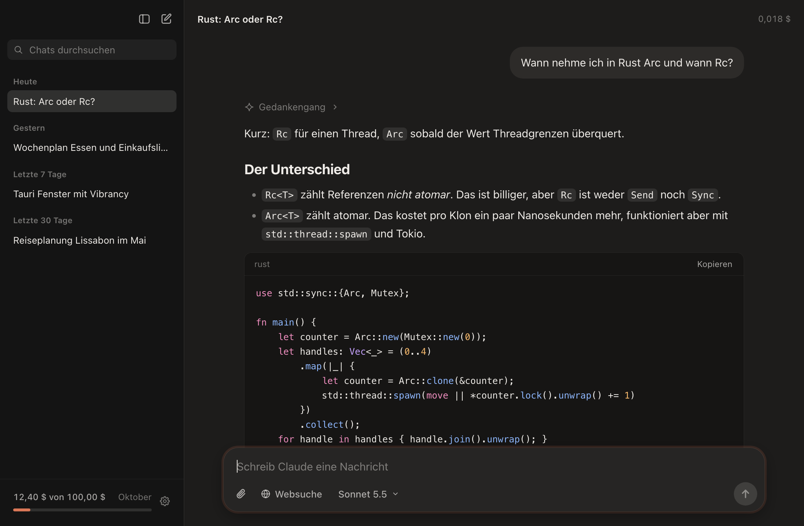
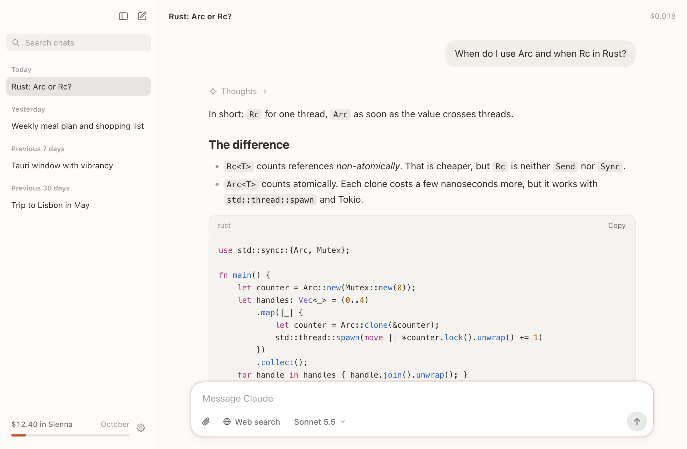
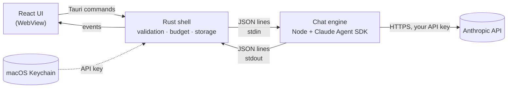

<div align="center">


# Sienna

**A small, fast, native-feeling Mac app for chatting with Claude models through your own Anthropic API key.**

Streaming answers · web search with sources · images and PDFs · cost per answer · monthly budget cap · key in the macOS Keychain

</div>

<p align="center">
  
  
</p>

> [!NOTE]
> Sienna is an independent open source project. It is not made, endorsed or supported by Anthropic. "Claude" and "Anthropic" are trademarks of Anthropic, used here only to say which service the app talks to.

## Why

Anthropic gives some accounts a monthly **API credit** that covers the Claude API, the Claude Agent SDK, Managed Agents and the Playground, but **not** Claude Code sessions or the Claude apps. Sienna puts that credit to use for everyday chatting and research, so your Claude subscription stays free for the work only it can do.

Every request goes to Anthropic with **your API key**, is billed to **your API organization**, and nothing in between collects data. Chats stay on your Mac.

## Features

- **Streaming chat** with Markdown, tables, syntax-highlighted code blocks and a copy button
- **Thinking summary** you can expand while the model reasons
- **Web search** as a toggle; answers cite their sources as links that open in your browser
- **Projects**: add a folder as a project in the sidebar; its chats are listed under it and every new chat there can read that folder, as in Claude Code
- **Project folders**: give a chat a folder and ask about its code ("How does login work?", "Where is X used?"). Claude can read and search that folder, nothing else, and cannot change files or run commands; the project's `CLAUDE.md` is included
- **Model and effort choice** per chat: Haiku 5.5, Sonnet 5.5 (default), Opus 5.5 or Fable 5.1, and five effort levels from low to max on a slider
- **Attachments** by button, drag and drop or paste: images, PDFs and text files such as code, Markdown, CSV, JSON or logs (up to 512 KB each, sent as text with the file name)
- **Context at a glance**: a ring below the composer shows how full the context window is; click it for the breakdown and to compact the conversation now. Automatic compaction shows as a line in the chat
- **Costs you can see**: per answer, per chat (header), per month (sidebar) and per model (settings)
- **Monthly budget cap**: once reached, the app stops sending
- **Regenerate or edit** the last exchange; the conversation resumes from the turn before it
- **Copy** any answer with one click
- **Chat history** grouped by day, with search, pinning, delete and rename (double-click or F2); titles are written by Haiku after the first answer
- **Native Mac look**: sidebar with the system material, light and dark mode, reduced motion and transparency respected
- **Keyboard first**: ⌘N new chat, ⌘, settings, ⌘\ sidebar, ⌘. stop, ↩ send, ⇧↩ new line

The interface is in English or German. It follows your Mac's language, or the one you pick in the settings (⌘,).

## Install

There are no signed releases yet; build it yourself (about three minutes).

**Requirements**

- macOS on Apple Silicon
- [Node.js](https://nodejs.org) 20 or later, for example `brew install node`
- [Rust](https://rustup.rs) and the Xcode Command Line Tools (`xcode-select --install`)
- An Anthropic API key from the [Claude Console](https://platform.claude.com/settings/keys)

**Build**

```bash
git clone https://github.com/Natunax/sienna-chat.git
cd sienna-chat
npm install
npm run sidecar:install
npm run app
```

`npm run app` signs the app with an Apple code signing certificate if your Mac has one (for example the "Apple Development" certificate Xcode creates), so macOS treats every new build as the same app and your Keychain approval sticks. Without a certificate it builds unsigned, and macOS asks for Keychain access again after each rebuild.

Move `src-tauri/target/release/bundle/macos/Sienna.app` to `/Applications` and open it. On first launch the app asks for your API key and stores it in the Keychain.

> [!TIP]
> Set a **spend limit** in the Claude Console (Settings → Billing) in addition to the budget in the app. The app's budget is a convenience; the Console limit is enforced by Anthropic.

## How it works



1. The UI sends a message with `chat_send`. The Rust shell checks the model, effort, attachments and the monthly budget, then writes one JSON line to the engine.
2. The engine (`sidecar/index.mjs`) keeps **one live Agent SDK query per chat** in streaming-input mode, so a follow-up message does not start a new process. It batches text deltas every 32 ms to keep the UI smooth.
3. Rust forwards the events to the window and books the cost of each finished answer.
4. At most three chats keep a live engine session; an idle one closes after ten minutes and resumes from its saved session when you write again.
5. Answers are rendered block by block: a new piece of text re-renders only the paragraph still being written.

| Path | What it is |
| --- | --- |
| `src/` | React UI: `store.ts` holds chats and the stream, `components/` the views |
| `src-tauri/src/` | Rust shell: `lib.rs` commands, `engine.rs` engine process, `keychain.rs`, `store.rs` |
| `sidecar/index.mjs` | Chat engine on the Claude Agent SDK, bundled into `sidecar/dist/engine.mjs` for the app |
| `src/i18n.ts` | Interface texts in English and German |
| `src/devMock.ts` | Browser preview with sample data, only in `npm run dev` |

## Privacy and security

- **The key stays in the Keychain.** It is never written to a file, a log or the UI. It reaches the engine process only through its environment.
- **No subscription fallback.** Without a key the Agent SDK would quietly use a logged-in Claude subscription. The engine refuses to start without an API key and runs with its own `CLAUDE_CONFIG_DIR` and no setting sources, so your Claude Code login, settings, hooks, plugins and memory are never loaded.
- **The model gets almost no tools on your Mac.** In a normal chat the only tool is `WebSearch`, and only while the web toggle is on. With a project folder it may also use `Read`, `Grep` and `Glob`, and a hook checks every call against the folder (symbolic links resolved), so nothing outside it can be read. There is no shell and no write access. The folder must be inside your home folder (not the home folder itself, not a hidden one like `~/.ssh`). The project's `CLAUDE.md` is read by Sienna itself; Claude Code's project settings, which could run hooks, are never loaded. `@path` mentions and slash commands in messages are not expanded; the only command Sienna sends is its own `/compact`. `WebFetch` is left out on purpose: a page the model reads could otherwise tell it to fetch an attacker's URL with parts of your conversation in it.
- **API keys only.** The app refuses OAuth tokens (`sk-ant-oat…`) and admin keys, and the engine stops a turn if the SDK reports any credential source other than the API key.
- **Rendered answers are sanitized** (marked + DOMPurify), the WebView runs under a strict Content Security Policy, remote images are not loaded, a navigation guard keeps the window on the app, and only `http`/`https` links open, in your default browser.
- **Your data:** chats and the monthly spend are JSON files in `~/Library/Application Support/io.github.natunax.sienna/`. The Agent SDK keeps its own transcript of each chat in `claude-config/` there; deleting a chat deletes both. Requests go only to Anthropic.

Found a vulnerability? See [SECURITY.md](SECURITY.md).

## Costs

Sienna counts only its own requests, from the token usage the API reports, priced by the Agent SDK. These are estimates. The Claude Console shows everything your organization spends, including other keys and the Playground, and is the source of truth. Rough guide per question and answer: Haiku well under a cent, Sonnet one to a few cents, Opus about twice Sonnet, more with web search or long chats.

## Development

```bash
npm install
npm run sidecar:install
npm run tauri dev     # the app with hot reload
npm run dev           # browser preview with sample chats, no key needed
```

`http://localhost:1430/?demo=chat` opens the sample chat in the browser preview, `?onboarding` shows the key setup and `?lang=en` switches to English.

Checks:

```bash
npx tsc --noEmit
cargo clippy --manifest-path src-tauri/Cargo.toml -- -D warnings
```

## Limitations

- macOS on Apple Silicon only; Node.js must be installed (looked up in Homebrew, `/usr/local`, Volta and `~/.local/bin`).
- The app bundle is about 245 MB: the chat engine is bundled into one 1 MB file, the rest is the Claude Code binary the Agent SDK runs, which cannot be made smaller.
- Not signed or notarized; macOS may ask you to confirm the first launch.

## License

[MIT](LICENSE)
